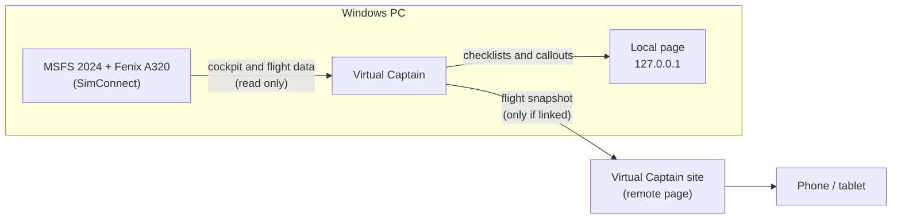

# Virtual Captain

**Virtual Captain** is a virtual captain for **Microsoft Flight Simulator 2024**: you fly as the First Officer on the **Airbus A320 Fenix**, and the captain reminds you what to do and checks your actions against the checklists, out loud and on screen.

This repository contains **only the releases** (the Windows program and the file that lets the app know whether a newer version exists). The source code is private.

➡️ **Download: coming soon.** The first public release is not available yet. When it is, you will find it in the [Releases](../../releases/latest) section.

---

## What it does

- **Callouts and reminders**: positive rate / gear up, acceleration altitude, transition altitude, 10,000 ft and the other standard moments of the flight, spoken by the captain.
- **Checklists** that read the real state of the cockpit from the simulator and show, item by item, what is right (green), wrong (red), waiting (blue) or only informative. Two modes: **Complete** and **Simplified**.
- **Briefing page**: you load your latest **SimBrief** plan (ID or username), review it and start the flight. The page also shows the weather: the QNH you set is compared with the real METAR.
- **Engine anti-ice** advice computed from the weather and the temperature, instead of the generic "as required".
- **Ground services** (GSX): refuel, catering and boarding items follow the real state of the services.
- **Read-only on the simulator**: Virtual Captain only reads data through **SimConnect**, it never writes anything to the aircraft.
- **Status window** with one line for each component (simulator, SimConnect, remote server, local page, flight, plan) and a coloured dot: green for OK, yellow for a warning, red for an error, grey for waiting.
- **Remote page**: after you link the program to your account on the Virtual Captain site (a one-time code you confirm in the browser), the flight page is also available on your phone or tablet.

## How it works

1. **Virtual Captain** reads the state of the aircraft and the flight from the simulator, about twice a second, through **SimConnect**.
2. It compares it with the **checklists** and with your **SimBrief plan**, and speaks or shows what to do.
3. The **local page** is served only on your PC. If you link the program to your account, a **snapshot** of the flight is also sent to the Virtual Captain site, so you can follow it from another device.

## Requirements

- **Windows** (tested on Windows 11).
- **Microsoft Flight Simulator 2024** with the **Airbus A320 Fenix**.
- **SimConnect.dll** (Microsoft's library to talk to the simulator): it is **not included** in the download. The program tells you what to do if it cannot find it.
- A **SimBrief** account if you want to load your plans (optional).

## Install and use

*Coming with the first release.* In short: download `VirtualCaptain-X.Y.Z.zip` from **Releases**, extract it to a folder of your choice (no need to install Python) and run the program.

The executable will not be digitally signed at first, so Windows may show a *"Windows protected your PC"* (SmartScreen) warning: choose **More info → Run anyway**. You will be able to check the zip with the **SHA-256** shown in the notes of each release.

## Updates

The app will read the [`latest.json`](latest.json) file of this repository to know the latest published version, and tell you when a newer one is available. It **will not download or install anything by itself**: you download the update from the Releases section. If there is no network, the program starts normally. This file is added with the first release.

## Known limits

- Windows only, and only with the **A320 Fenix**.
- Italian is still used in a few places of the checklists and the web pages; the program window and messages are in English.
- The executable is not signed: Windows may show a warning at first launch.

## About this repository

| File | What it is for |
|---|---|
| `README.md` | This page |
| `LICENSE` | Terms of use |
| `latest.json` | Latest version, download address and SHA-256 hash, read by the app (added with the first release) |
| Releases | The `VirtualCaptain-X.Y.Z.zip` packages (from the first release) |

## License

**Non-commercial** use is allowed, **without modifications**. Any commercial purpose is prohibited and must be agreed in writing by emailing **andrea@rossinisolutions.com**. The full text is in the [`LICENSE`](LICENSE) file.

A personal project by **Andrea Rossini**, **Rossini Solutions**. Virtual Captain is an independent project and is not affiliated with Fenix Simulations, Microsoft, Asobo or Navigraph/SimBrief.
